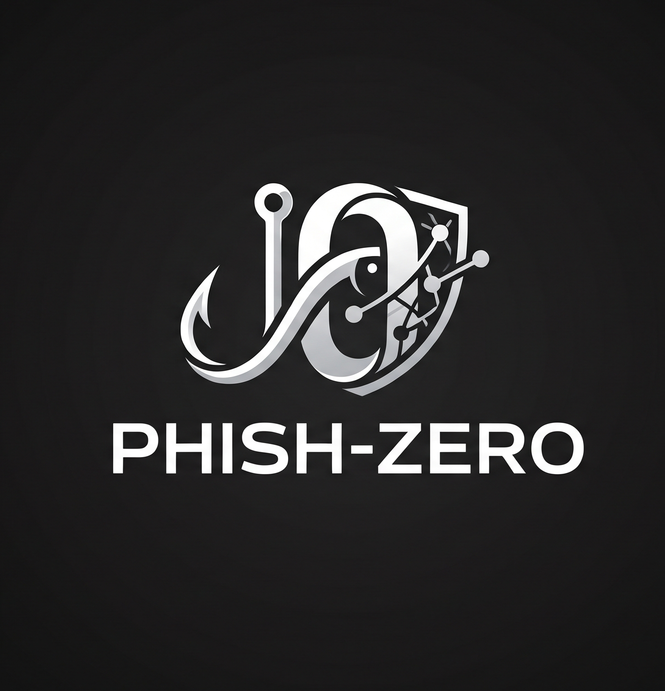

# phish-zero

<p align="center">
  
</p>

<p align="center">
  <strong>Fast, offline link &amp; QR code forensics powered by Explainable AI (XAI).</strong><br>
  Inspect deceptive URLs and credential-harvesting lures locally — with zero data leakage.
</p>

<p align="center">
  <a href="https://www.python.org/"></a>
  <a href="LICENSE"></a>
  <a href="#"></a>
  <a href="#"></a>
  <a href="#"></a>
</p>

---

`phish-zero` is a privacy-first link forensics tool and phishing intelligence engine. It deconstructs suspicious URLs and QR code payloads ("quishing"), unmasks brand impersonation tricks, and calculates risk using a character $n$-gram machine learning model paired with structural heuristics — entirely on your local machine without ever contacting the target destination.

---

## ⚡ Quickstart

### 1. Clone & Install
```bash
git clone https://github.com/securitygeek15/phish-zero.git
cd phish-zero

# Create and activate virtual environment
python -m venv .venv

# Windows (PowerShell):
.\.venv\Scripts\Activate.ps1

# macOS / Linux:
source .venv/bin/activate

# Install dependencies
pip install -r requirements.txt
```

### 2. Launch
```bash
python app.py
```
Open **[http://127.0.0.1:5000](http://127.0.0.1:5000)** in your browser.

---

## 🛡️ Core Capabilities

### 📷 QR Code Phishing ("Quishing") Engine
- **100% Client-Side Decoding**: Uses vendored `jsQR` to unpack QR codes directly in your browser. Not a single pixel leaves your system.
- **Multiple Ingestion Modes**: Drag-and-drop, file upload, or simply hit `Ctrl + V` anywhere to paste a screenshot directly from your clipboard.
- **Sub-5ms Execution**: Automatically extracts embedded payloads and triggers the forensic inspection pipeline in under 5ms.

### 🔬 Explainable AI (XAI) Attribution Lens
- **Zero Black-Box**: Decomposes the model's decision boundary ($z = \beta_0 + \sum x_j \beta_j$) into exact linear Shapley weights without slow perturbation sampling (e.g., LIME).
- **Interactive Character Risk Heatmap**: Highlights malicious sub-tokens (`.tk`, `update`, `/login`) in neon red/amber, while trusted structural anchors glow in emerald green. Hovering or tapping any character reveals its exact local weight and primary $n$-gram pattern.
- **Dual Attribution Stream**: Ranks the top positive threat drivers vs. negative trust anchors alongside a plain-English AI decision synthesis narrative.

### 🔍 Interactive URL Dissector
- Splits URLs into scheme, subdomains, registered apex domain, TLD, port, and query parameters.
- Analyzes Shannon character entropy, flags suspicious disposable TLDs (`.tk`, `.ml`, `.xyz`), and unmasks brand impersonation patterns.

### 📊 Threat Surface Radar & Route Topology
- **6-Axis Risk Radar**: Evaluates Lexical Randomness, Host Deception, Brand Spoofing, TLD Risk, Transport Security, and Credential Intent.
- **Route Topology Flow**: Visualizes diversion paths when an attacker uses a trusted brand name as a lure to route traffic to an unauthorized apex domain.

### 🔒 100% Zero-Egress Privacy
Unlike traditional link scanners, `phish-zero` **never crawls the target site or transmits the URL over the wire**. Sensitive password-reset tokens, internal staging domains, and one-time invite codes remain completely private.

---

## 🎯 4-Tier Security Verdicts

| Level | Verdict | Indication | Typical Examples |
| :--- | :--- | :--- | :--- |
| **Dangerous** | 🔴 Red | High-confidence deception or brand spoof | Fake login forms, deceptive subdomains (`paypal.com.attacker.tk`) |
| **Warning** | 🟡 Yellow | Elevated risk factors present | Raw IP destinations, free application hosts, unencrypted logins |
| **Caution** | 🔵 Blue | Unverified or low-risk domain | Personal blogs, public open-source repos, unclassified domains |
| **Safe** | 🟢 Green | Verified authority domain | Official trusted domains (`google.com`, `github.com`) |

---

## 📈 Model Performance & Accuracy

Trained and evaluated on **266,593 URLs** using domain-partitioned `GroupShuffleSplit` (zero hostname overlap between train and test sets):

| Metric | Score | Note |
| :--- | :--- | :--- |
| **Accuracy** | **98.32%** | Overall correct classifications |
| **Phishing Precision** | **99.78%** | Minimized false accusations |
| **Phishing Recall** | **96.15%** | Catches 96.2% of real-world attacks |
| **False Positive Rate** | **0.15%** | Less than 1 in 650 safe sites flagged |
| **Inference Latency** | **&lt; 5ms** | Sub-word TF-IDF + Logistic Regression |

---

## 🔌 REST API

Integrate `phish-zero` directly into security pipelines, mail relays, or automation workflows.

### Audit Link or QR Payload
```bash
curl -X POST http://127.0.0.1:5000/api/analyze \
  -H "Content-Type: application/json" \
  -d '{"url": "http://paypal-verification-account-update.tk/login"}'
```

<details>
<summary>Click to view sample JSON response</summary>

```json
{
  "url": "http://paypal-verification-account-update.tk/login",
  "hostname": "paypal-verification-account-update.tk",
  "registered_domain": "paypal-verification-account-update.tk",
  "prediction": "phishing",
  "threat_level": "danger",
  "threat_label": "DANGEROUS // THREAT CONFIRMED",
  "phishing_score": 100.0,
  "ml_score": 99.9,
  "heuristic_score": 100.0,
  "is_top_authority": false,
  "xai": {
    "status": "ready",
    "decision_logit": 10.361,
    "ml_probability": 100.0,
    "top_risk_tokens": [
      { "ngram": "tk/", "weight": 3.55, "contrib": 0.35 },
      { "ngram": ".tk/", "weight": 3.54, "contrib": 0.35 }
    ],
    "narrative": "The model's linear decision boundary flagged this URL with a logit of +10.36..."
  }
}
```
</details>

---

## ⌨️ Helpful Keyboard Shortcuts

| Shortcut | Action |
| :--- | :--- |
| `/` | Instantly focus and select the URL input bar |
| `Ctrl + V` | Paste any QR screenshot from clipboard anywhere to audit instantly |
| `Esc` | Close QR scanner modal or clear the URL input bar |
| `Enter` | Run the security audit |

---

## 📁 Project Structure

```text
phish-zero/
├── app.py                 # Flask server & REST API
├── xai_explainer.py       # Linear Shapley Explainable AI engine
├── url_features.py        # URL dissector, Shannon entropy & heuristics
├── train.py               # Model training script with GroupShuffleSplit
├── requirements.txt       # Python dependencies
├── assets/
│   └── logophishzero.png  # High-resolution brand logo
├── data/
│   └── urls.csv           # Reference training dataset
├── model/
│   ├── url_model.joblib   # Pre-trained model bundle
│   └── metrics.json       # Benchmark metrics and validation report
├── static/
│   ├── app.js             # UI interactivity, XAI heatmap & SVG charts
│   ├── style.css          # Design system, glassmorphic HUD & threat styling
│   ├── jsqr.min.js        # Vendored offline client-side QR decoder (zero-egress)
│   ├── emblem.png         # Glassmorphic navbar brand emblem
│   ├── favicon.ico        # Root browser favicon
│   ├── favicon.png        # High-DPI browser icon
│   └── samples/           # Pre-packaged quishing test QR samples
├── templates/
│   └── index.html         # Web application interface & Quishing HUD modal
└── tests/
    └── test_app.py        # Automated test suite (11 unit test cases)
```

---

## 📄 License

This project is open-source and available under the [MIT License](LICENSE).
